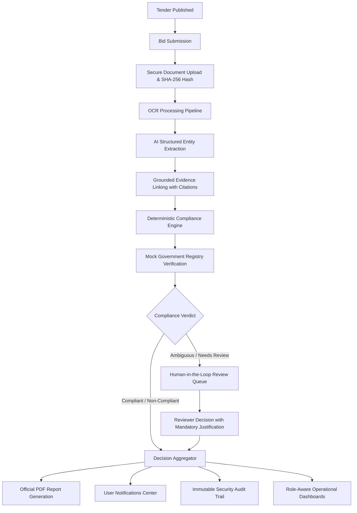

# BIDVERIFY AI — AI-Powered Bid Compliance Verification Platform

**Smart India Hackathon (SIH 2026) — Problem Statement ID: 26100**  
*Automating Procurement Verification for the Government e-Marketplace (GeM)*

---

## 📌 Executive Summary

**BIDVERIFY AI** is an enterprise-grade, end-to-end automated bid compliance verification system tailored for Indian public procurement workflows. The platform automates complex tender requirement analysis, document ingestion, optical character recognition (OCR), structured AI entity extraction, grounded evidence linking, deterministic rule evaluation, simulated government registry verification (GSTN, PAN, MSME), human-in-the-loop review overrides, tamper-evident audit logging, and automated compliance report generation.

---

## 🏛️ System Architecture & Workflow



---

## 🎭 5-Tier Role-Based Access Control (RBAC)

| Role | Responsibilities | Key Capabilities |
| :--- | :--- | :--- |
| **`ADMIN`** | Platform Governance & Security | System monitoring, role assignment, platform-wide metrics, security audit logs. |
| **`PROCUREMENT_OFFICER`** | Tender Creation & Evaluation | Create/publish tenders, define criteria, evaluate bids, download official PDF reports. |
| **`BIDDER`** | Bid Submission & Discovery | Discover tenders, submit bids, upload supporting documents, monitor live verification. |
| **`REVIEWER`** | Technical Evaluation Committee | Inspect evidence snippets, review flagged bids, submit decision overrides with justification. |
| **`AUDITOR`** | Independent Compliance & Vigilance | Read-only access to global compliance statistics, reports, and tamper-evident audit trail. |

---

## 🚀 Quickstart Guide

### Prerequisites
- **Python 3.12+**
- **Node.js 20+** and **npm**
- **PostgreSQL 16+** (or SQLite for testing)

---

### Backend Setup (FastAPI)

1. **Navigate to `backend/`**:
   ```bash
   cd backend
   ```

2. **Create and activate a virtual environment**:
   ```bash
   python -m venv venv
   # On Windows:
   .\venv\Scripts\activate
   # On Linux/macOS:
   source venv/bin/activate
   ```

3. **Install dependencies**:
   ```bash
   pip install -r requirements.txt
   ```

4. **Seed SIH Demo Data (All 5 Roles & Sample Tenders/Bids)**:
   ```bash
   python seed.py
   ```

5. **Run Backend Server**:
   ```bash
   uvicorn app.main:app --reload --host 127.0.0.1 --port 8000
   ```
   - **API Root**: `http://127.0.0.1:8000`
   - **Interactive OpenAPI Documentation (Swagger)**: `http://127.0.0.1:8000/api/v1/docs`

6. **Run Test Suite**:
   ```bash
   pytest
   ```

---

### Frontend Setup (Next.js 16 + Tailwind CSS)

1. **Navigate to `frontend/`**:
   ```bash
   cd frontend
   ```

2. **Install dependencies**:
   ```bash
   npm install
   ```

3. **Start development server**:
   ```bash
   npm run dev
   ```
   - **Web UI**: `http://localhost:3000`

4. **Build for production**:
   ```bash
   npm run build
   ```

---

## 🔑 SIH Demo Credentials

*Standard Password for all Demo Accounts:* **`DemoPass123!`**

| Role | Demo Email | Access Scope |
| :--- | :--- | :--- |
| **Admin** | `admin@gem.gov.in` | Complete system telemetry & audit trail |
| **Procurement Officer** | `officer@gem.gov.in` | Tender management & report generation |
| **Bidder** | `bidder@vendor.in` | Bid submission & document upload |
| **Reviewer** | `reviewer@gem.gov.in` | Human review queue & decision overrides |
| **Auditor** | `auditor@gem.gov.in` | Read-only vigilance & compliance inspection |

---

## 🗺️ Project Milestones (100% Completed)

- [x] **Phase 0: Project Setup & Foundation** — Monorepo architecture, FastAPI backend, Next.js frontend, Pydantic schemas.
- [x] **Phase 1: Database & Migrations** — PostgreSQL models, Alembic migrations, connection pooling.
- [x] **Phase 2: Authentication & RBAC** — JWT token management, 5-role RBAC, permission decorators, password hashing.
- [x] **Phase 3: Tender Management** — Multi-category tender lifecycle, criteria definition, search & filters.
- [x] **Phase 4: Secure Document Management + OCR** — SHA-256 integrity hashing, MIME & magic bytes validation, OCR pipeline.
- [x] **Phase 5: AI Extraction + Evidence Management** — Structured entity extraction (GSTIN, PAN, turnover), grounded evidence linking.
- [x] **Phase 6: Compliance Engine + Verification** — Deterministic rule engine, mock government registry verification.
- [x] **Phase 7: Human Review + Reports** — Review tasks lifecycle, decision overrides with justification, PDF report generation.
- [x] **Phase 8: Dashboards + Notifications + Audit** — Role-aware dashboards, in-app notification center, security audit inspection.
- [x] **Phase 9: Security Hardening + Performance** — Rate limiting, brute-force protection, security headers, E2E integration tests.
- [x] **Phase 10: Final Polish & SIH Submission** — Comprehensive demo dataset, documentation, zero-regression verification.

---

## 🛡️ Security & Privacy Architecture

- **Zero Credential Leakage**: Passwords, tokens, and secrets are strictly redacted from audit streams and API error responses.
- **Path Traversal Protection**: Uploaded filenames are sanitized and isolated in unique hashed directories.
- **MIME & Magic Bytes Enforcement**: Disguised executables and untrusted filetypes are rejected at the edge.
- **Cryptographic Grounding**: Every compliance decision links to verifiable page citations and document hashes.
- **Simulated Registry Transparency**: External registry verifications are explicitly tagged and recorded as simulated.
